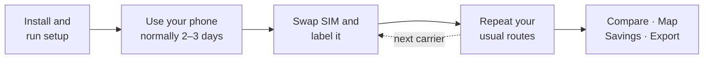

<div align="center">


# Datavarge

**Find out which carrier actually works where you go.**

Logs your phone's cellular signal in the background, maps it, and compares carriers on the same places, plus what switching would save.

[](https://github.com/jinst255/datavarge/releases/latest)


[](LICENSE)

**[Download the APK](https://github.com/jinst255/datavarge/releases/latest)**

</div>

---

## Features

| | |
|---|---|
| 📡 **Passive logging** | A sample every 20 m you move, and every 10 min while still. A density cap keeps one spot from piling up. Dead zones are logged too. |
| ⚡ **Test now** | Logs the exact spot on demand, with an optional speed test forced over **cellular** even on Wi-Fi (~11 MB). |
| 🗺️ **Map** | 20 m heat-map cells colored by median signal. Pick two carriers for a win/tie/lose difference map. |
| 📊 **Compare** | Place-weighted median, worst 10%, % usable places, no-service %, speed medians, and a fair head-to-head on shared places. No single "winner" verdict. |
| 💵 **Savings** | Monthly and yearly cost of a few US prepaid plans vs. what you pay now, with hotspot and tax estimates. |
| 📦 **Export** | Zip with CSVs and a self-contained `heatmap.html` to open on a computer. |

**Signal colors** (LTE RSRP / 5G SS-RSRP):


## How to compare carriers



Only one SIM is measured at a time, so the comparison comes from swapping SIMs and repeating similar routes. The head-to-head needs at least **20 shared places** (20 m cells with 3+ samples from each carrier).

## Install

1. Download `datavarge-x.y.z.apk` from the [latest release](https://github.com/jinst255/datavarge/releases/latest) on your phone, open it, and allow **Install unknown apps** when asked.
2. Follow the setup wizard:
   - Location: **Precise**, then **Allow all the time**
   - Phone and Notifications: **Allow**
   - Battery: allow background running
3. **Samsung** (and other phones that kill background apps):
   - Settings › Apps › Datavarge › Battery › **Unrestricted**
   - Settings › Battery › Background usage limits: keep Datavarge **out of Sleeping apps and Deep sleeping apps**. This is the step most people miss.

> [!TIP]
> When you swap SIMs, the app asks *"New SIM detected. What should we call it?"* Pick a suggestion (AT&T, Verizon, T-Mobile, Boost, Tello, US Mobile, Mint, Visible, Cricket, Metro, or the name the SIM reports) or type your own. Phones often report the host network instead of the brand (a Tello SIM may say "T-Mobile"), which is why you name it.

## Privacy

All data stays on the phone: no accounts, analytics, or cloud backup. The only network traffic is OpenStreetMap map tiles and speed tests to Cloudflare. **More › Delete all data** wipes everything. Uninstalling does too, so export first.

<details>
<summary><b>Build from source</b></summary>

Needs JDK 17+ and the Android SDK command-line tools with platform 37 (`ANDROID_HOME` set). No Android Studio required.

```sh
./gradlew assembleDebug        # app/build/outputs/apk/debug/app-debug.apk
./gradlew testDebugUnitTest    # density cap, grid and bins, head-to-head, savings math
adb install -r app/build/outputs/apk/debug/app-debug.apk
adb logcat -s Datavarge        # app log
```

Stack: Kotlin, Jetpack Compose, Room, Play Services location, osmdroid, OkHttp, WorkManager. minSdk 31, targetSdk 37. Tunable constants live in [`Config.kt`](app/src/main/java/app/datavarge/Config.kt); plan prices in [`plans.json`](app/src/main/assets/plans.json).

To enable USB debugging: Settings › About phone › (Software information ›) tap **Build number** 7 times, then Developer options › **USB debugging**.

</details>

<details>
<summary><b>Export and data files</b></summary>

**More › Export** saves `datavarge_export_YYYYMMDD_HHMM.zip` to Downloads and offers Share. Or pull it over USB:

```sh
adb pull /sdcard/Download/datavarge_export_YYYYMMDD_HHMM.zip .
```

| File | Contents |
|---|---|
| `heatmap.html` | Interactive map. Open in a desktop browser (needs internet for tiles). |
| `samples.csv` | One row per logged point: location, accuracy, carrier label, network type, dBm, RSRQ/SNR, band, cell, trigger, note. |
| `speed_tests.csv` | Download/upload/latency per Test now, and whether it ran on cellular. |
| `README.txt` | Field descriptions. |

**More › Share debug log** exports the app's local log for troubleshooting.

</details>

<details>
<summary><b>Known limitations</b></summary>

- One SIM at a time; a fair comparison needs similar routes on each.
- Signal strength is not speed. Speed varies with time of day and congestion.
- GPS altitude can't tell floors apart. Use the Test now note ("garage level 2"). Phones with a barometer get a Level filter.
- Android or Samsung may still stop the app. A watchdog restarts it or notifies you, and it resumes after reboots and updates.
- Airplane mode pauses logging rather than counting as a dead zone.
- Plan prices are a snapshot (checked Nov 9, 2026) of a few US prepaid plans, and sources disagree. Verify before switching, or edit `plans.json` to compare others.
- A spot that already has its 6 samples stops collecting automatic ones. That's intended; "hours logged" is tracked separately.

</details>
